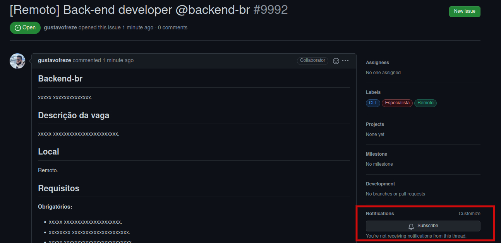

<!--suppress HtmlDeprecatedAttribute -->

  

# Vagas

Espaço para a divulgação de vagas para desenvolvedores backend via issues do Github.

## Como cadastrar uma vaga?

Abra uma [issue](https://github.com/backend-br/vagas/issues/new/choose) usando o formulário em português ou em
inglês. Os labels de nível, regime e modelo de trabalho são aplicados a partir do formulário.

Toda vaga nova passa por uma triagem automática:

- Uma vaga por issue, apenas para backend (ou fullstack com foco em backend).
- Vagas de treinamento de IA, anotação de dados ou avaliação de modelos não são aceitas.
- Cada autor pode publicar até 8 vagas a cada 7 dias.
- Vagas aprovadas recebem o label `verificada`. Vagas com dúvida recebem `em-triagem` e são revisadas por uma pessoa
  mantenedora. Vagas recusadas são fechadas com um comentário explicando o motivo; basta editar a issue para ela ser
  reavaliada.

Para ver apenas vagas aprovadas, use o filtro
[`label:verificada`](https://github.com/backend-br/vagas/issues?q=is%3Aissue+is%3Aopen+label%3Averificada).

Para mantenedores: revise as vagas em
[`label:em-triagem`](https://github.com/backend-br/vagas/issues?q=is%3Aissue+is%3Aopen+label%3Aem-triagem). Para
aprovar, troque `em-triagem` por `verificada`; autores com 3 vagas verificadas passam a ir direto para `verificada`. Para
que a triagem nunca mais altere uma issue, adicione `revisada`. As regras ficam em `.github/triage/config.json`.

### Posting a job in English

Open an [issue](https://github.com/backend-br/vagas/issues/new/choose) with the English form. Posts go through the same
automatic triage: one backend job per issue, no AI training gigs, up to 8 posts per author every 7 days.

## Como receber atualizações das vagas?

Você pode receber atualizações das vagas no seu e-mail ou via notificações do GitHub, basta clicar **Subscribe**, na
issue que você tem interesse.

Você também pode [pesquisar e filtrar as vagas da Backend BR no openings.dev](https://openings.dev/communities/backend-br/vagas). Cada resultado continua levando à issue original neste repositório.

    
     
    <tl>Ativar notificações.</tl>

## Outros repositórios de vagas

### Por área

- [Vagas para QAs](https://github.com/qa-brasil/vagas)
- [Vagas para Chat-Bot](https://github.com/chatbotbr/vagas)
- [Vagas para Back-End](https://github.com/backend-br/vagas)
- [Vagas para Front-End](https://github.com/frontendbr/vagas)

### Por tecnologia

- [Vagas para PHP](https://github.com/phpdevbr/vagas)
- [Vagas para .NET](https://github.com/dotnetdevbr/vagas)
- [Vagas para Rust](https://github.com/rustdevbr/vagas)
- [Vagas para Kotlin](https://github.com/kotlin-br/vagas)
- [Vagas para Vue.js](https://github.com/vuejs-br/vagas)
- [Vagas para Android](https://github.com/androiddevbr/vagas)
- [Vagas para Flutter](https://github.com/flutter-brazil/vagas)
- [Vagas para iOS e OSX](https://github.com/CocoaHeadsBrasil/vagas)
- [Vagas para Go/Golang](https://github.com/Gommunity/vagas)
- [Vagas para React/React Native](https://github.com/react-brasil/vagas)
- [Vagas para Python](https://github.com/pydevbr/vagas)
- [Vagas para Node.JS](https://github.com/nodejsdevbr/vagas)

### Por localidade

- [Vagas para no Ceará](https://github.com/CangaceirosDevels/vagas_de_emprego)
- [Vagas para Back-end (Angola)](https://github.com/backend-ao/vagas)
- [Vagas para Front-end (Angola)](https://github.com/frontend-ao/vagas)
- [Vagas para Back-end (Portugal)](https://github.com/backend-pt/vagas)
- [Vagas para Front-end (Portugal)](https://github.com/frontend-pt/vagas)
- [Vagas para Back-end e Frontend(Brasil)](https://github.com/rafaelsilva81/githubvagasbrasil)

## Licença

Licenciado sob [MIT](LICENSE).

## Contribuindo

Siga as [diretrizes de contribuição](CONTRIBUTING.md) para contribuir com o projeto.

## Agradecimento

Agradecemos a comunidade [Front-end Brasil](https://github.com/frontendbr) que nos inspirou, e essa página é um fork
deles.
